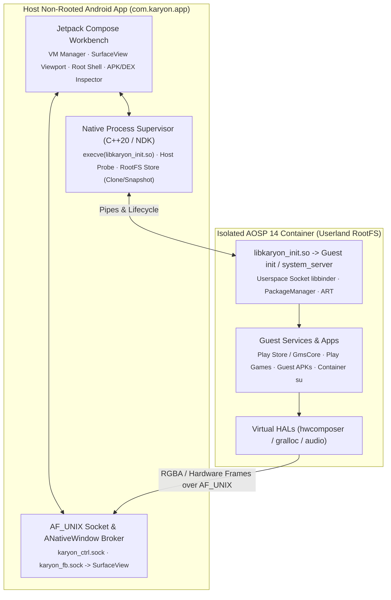

<div align="center">

# karyon.

**Rootless system-level AOSP 14 container runtime and workbench for Android.**

-C6F432?style=flat-square&labelColor=161814)
-C6F432?style=flat-square&labelColor=161814)


</div>

---

## Overview

**Karyon** is a system-level Android-on-Android container platform built to boot an independent **AOSP 14 userland OS** inside a standard, **non-rooted** Android app (`com.karyon.app`).

Unlike single-app Binder-hooking sandboxes (which share the host `PackageManager`, host `GmsCore`, and host APK signing certificate — breaking third-party Google Play Games sync and cross-app isolation), Karyon separates the architecture cleanly into two halves:

1. **Host Supervisor & Workbench APK (`Karyon.apk`)**:
   - Manages isolated VM instances (`rootfs/`, `overlay/`, `snapshots/`, `sockets/`), Copy-on-Write delta cloning, and point-in-time snapshots.
   - Executes container bootstrap helpers from `nativeLibraryDir` (`libkaryon_init.so`) in compliance with Android 10+ W^X policies.
   - Runs a real `AF_UNIX` IPC & Framebuffer Broker (`karyon_ctrl.sock`, `karyon_fb.sock`) driving an `ANativeWindow` hardware `SurfaceView` viewport.
   - Probes host constraints (`SELinux`, `memfd_create`, ABI, Android 12+ Phantom Process Killer guidance).
   - Reuses Dexe's C++20 `dexe_core` DEX disassembler and binary `AndroidManifest.xml` (`axml_parser`) engine for APK & DEX inspection.

2. **Patched AOSP 14 Guest RootFS (`aosp/`) — Built on Linux / WSL2**:
   - Compiles an AOSP 14 userland rootfs (`init`, `servicemanager`, `system_server`, `zygote`, `SurfaceFlinger`, `installd`, `su`, and optional GApps/Play Store packages) using userspace socket `libbinder` routing and Virtual HAL bridges into Karyon's host display/input/audio sockets.

---

## Architecture



---

## Project Status

- **Phase 1 (Implemented & Verified Now):** Host APK (`com.karyon.app`), C++20 `dexe_core` + `axml_parser`, VM `RootfsStore` (ensure/clone/snapshot/restore/delete), Host Capability & Phantom Process Killer probe, `libkaryon_init.so` W^X child supervisor, `AF_UNIX` control & RGBA framebuffer sockets driving `ANativeWindow` `SurfaceView`, TAR RootFS importer & structural verifier, diagnostic/root shell, and APK/DEX inspector.
- **Phase 2 (Linux / WSL2 Build Required):** Building and shipping the full patched AOSP 14 + GApps + `su` rootfs tarball (`karyon-rootfs-aosp14-arm64.tar`) under [`aosp/`](aosp/README.md).

---

## Host Requirements & Honest Constraints (Non-Rooted Android)

- **Android 12–15 Phantom Process Killer:** Stock Android limits child processes (`max_phantom_processes=32`). Full multi-process AOSP + GMS requires disabling child process restrictions via Developer Options ("Disable child process restrictions" where available) or Wireless Debugging (`device_config put activity_manager max_phantom_processes 2147483647`). Karyon probes Android version and provides copy-ready commands in the Dashboard.
- **Play Integrity:** Inside an uncertified userland AOSP rootfs with `su`, `GmsCore` sees each guest app's genuine package name and signing certificate via the guest `PackageManager`, enabling standard Google Play sign-in once GApps is installed in the rootfs, while apps enforcing strict hardware Play Integrity (`MEETS_DEVICE_INTEGRITY` / `MEETS_STRONG_INTEGRITY`) may still detect an uncertified/rooted environment.

---

## Building Karyon.apk

### Prerequisites
- Android SDK Platform 35 & Build-Tools
- Android NDK `27.0.12077973` & CMake `3.22.1`
- JDK 17+

```powershell
.\gradlew.bat :app:assembleDebug :app:testDebugUnitTest
```
